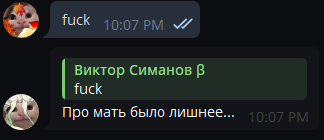
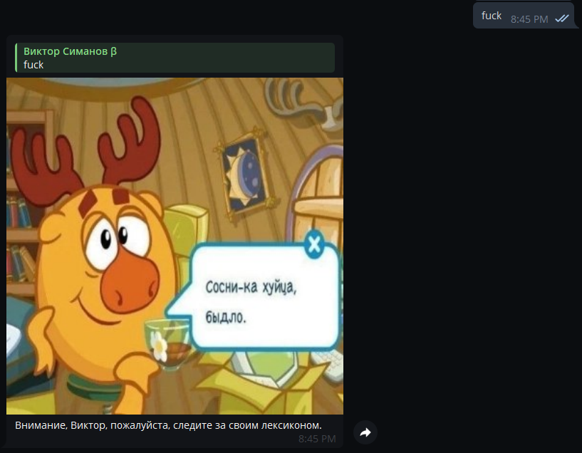
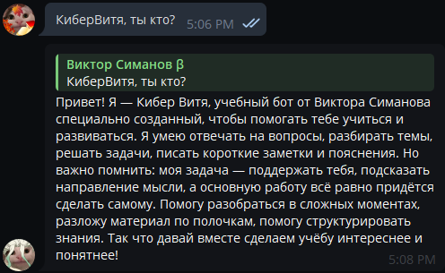
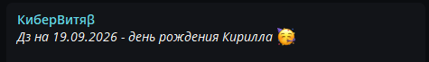
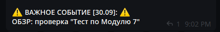
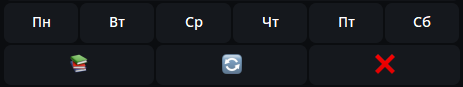
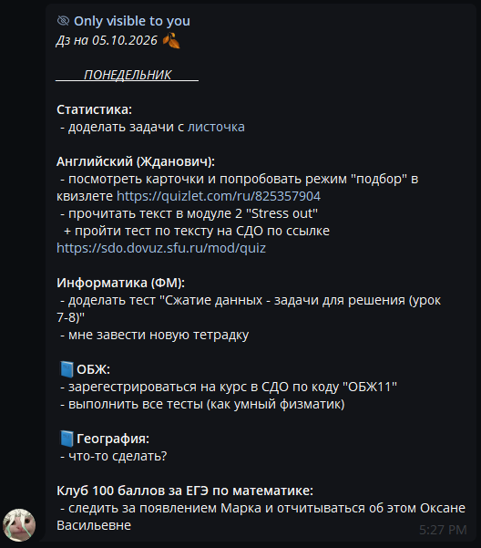

# Telegram

## Команды бота:

- `/start /help `- *Выводит стартовое сообщение*
- `/dz /дз` - *Отправка домашнего задания на завтра ["узнать дз на завтра"]*
- `/fuldz /фулдз` - *Отправка всего известного домашнего задания ["узнать всё известное дз"]*
- `/consultation /консультация` - *Отправка списка консультаций на сегодня ["консультации на сегодня"]*
- `/consultations /консультации` - *Отправка списка консультаций на недулю ["список всех консультаций"]*
- `/group /группа` - *Отправка домашнего задани на завтра в группу класса [Команда для админа]*
- `/group_full /группа_фулл` - *Отправка домашнего задани на неделю в группу класса [Команда для админа]*
- `/check /проверь /проверить <слово для проверки>` - *Проверка слова по словарю*

## Возможности бота

- Отвечает на сообщения пользователей с нецензурной лексикой случайной фразой или картинкой




- Отвечает на сообщения пользователя, содержащие обращение к боту, используя модель ИИ GigaChat



- При отправке домашнего задания на завтра в начале сообщения пишет "Дз на день рождения <кого>", если в этот день назначен чей-то день рождения



- При отправке домашнего задания на завтра в конце сообщения пишет "⚠ ВАЖНОЕ СОБЫТИЕ [<дата>]: ⚠ <событие>", если в этот день назначено событие



- Сообщение с домашним заданием на завтра имеет кнопки, благодаря которым пользователи могут посмотреть задание на другие дни или на всю неделю, что происходит посредствам эфемерных сообщений, которые видны только пользователям, активировавшим эту функцию





# Код

## Зависимости

```bash
pip install pyTelegramBotAPI
```

## HTML форматирование

```html
<b> bold </b>
<i> italian </i>
<u> underline </u>
<s> strikethrough </s>
<span class="tg-spoiler"> spoiler </span>
<a href="www.ling.ru"> link </a>
<code> monospace piece of text </code>
<pre> code block </pre>

< - &lt
> - &gt
& - &amp
```

## Структура проекта

```
Botik/
|- .gitignore
|- README.md
|- main.py
|- utils.py
|- config.cfg
|- pictures/...
|- README.images/...
|- homework/
|  |- monday.txt
|  |- tuesday.txt
|  |- wednesday.txt
|  |- thursday.txt
|  |- friday.txt
|  '- saturday.txt
'- data/
   |- birthdays.txt
   |- consultations.txt
   |- events.txt
   |- preambula.txt
   |- proxy.txt
   '- word_bank.py

```

### `config.cfg`

Содержит переменные для базовой конфигурации бота.

**Структура:**

```cfg
telegram_api_key = "<ключ бота в Телеграмме>"
owner_id = <ID владельца>
owner_name = "<содержимое поля "Имя" аккаунта владельца>"
main_group_id = <ID группы>
gigachat_api_key = "ключ от API Gigachat"
```

### `events.txt`

Содержит важные события.

**Структура**

```text
<день>.<месяц>--<название события> \\
```

**Пример:**

```text
14.09--Важное событие \\
31.05--Важное 
многострочное
событие \\
```

### `preambula.txt`

Содержит текст-задачу для ИИ, которая приписывается в начало сообщения пользователя, после чего передаётся агенту в качестве промпта.

**Пример:**
```text
Ты ИИ, внедрённый в учебного бота в Телеграмме. Тебя зовут Кибер Витя, твой создатель - Виктор Симанов. Я категорически запрещаю тебе полностью делать работу за ученика, сочинять тексты за него, однако позволяю оказывать лишь небольшую помощь. Длина твоего ответа должа быть не более 150 слов. Дай ответ на следующее сообщение ученика без использования форматирования текста:
```

### `consultations.txt`

Содержит список консультаций на неделю

**Образец (обратите внимание на количество пустых разделительных строк):**

```html
<u><i>_____ПОНЕДЕЛЬНИК_____</i></u>

<b>Физика:</b>
  + 16:00 - 17:40
    каб. 2-15 / Воробьёва А.Ю.

<b>Информатика:</b>
  + 16:00 - 17:00
    каб. 1-18 / Малышева Ж.О.


<u><i>_____ВТОРНИК_____</i></u>

<b>Физика:</b>
  + 7:00 - 8:00
    каб. 2-15 / Воробьёва А.Ю.


<u><i>_____СРЕДА_____</i></u>

<b>Химия:</b>
  + 15:15 - 16:00 (8 урок)
    каб. 2-05 / Агапченко В.А.


<u><i>_____ЧЕТВЕРГ_____</i></u>

<b>Физика:</b>
  + 7:00 - 8:30
    каб. 2-15 / Воробьёва А.Ю.

<b>Математика:</b>
  + с 16:00
    каб. 2-02 / Винк О.В.


<u><i>_____ПЯТНИЦА_____</i></u>

<b>Информатика:</b>
  + 14:20 - 16:00 (7-8 уроки)
    каб. 4-15 / Казак Е.С.
    каб. 1-11 / Голубев Р.А.
  + 15:15 - 17:00
    каб. 3-23 / Горбунова К.Д.
    каб. 1-18 / Малышева Ж.О.
```

### `proxy.txt`

Содержит IP-адреса и порты различных SOCKS5 прокси, к которым программа поочерёдно пытается подключиться при первом запуске.

**Пример:**

```text
43.135.176.121:1080
94.156.114.45:1080
178.130.47.21:1082
150.136.58.221:1080
5.231.45.243:9092
47.251.127.154:1080
5.75.133.113:10811
174.138.165.213:34324
```

### `birthdays.txt`

Содержит список дней рождений учеников.

**Структура:**

```text
<день>.<месяц>--<имя [, фамилия] в родительном падеже>
```

**Пример:**

```text
06.05--Вити Симанова
19.09--Кирилла
```

### `word_bank.py`

Содержит словари для определения категории сообщения. 

*Категории:*
- `swearing` - ругательства
- `dz_question` - вопрос о домашке
- `sorry` - извинение
- `gratitude` - благодарность
- `cyber_vitya` - обращение к боту

*Подтипы:*
- `contains` - текст содержит данное значение в качестве подстроки
- `equals` - текст содержит данное значение в качестве отдельного слова / словосочетания

**Структура / Пример:**
```python
word_bank = {
    "swearing": {
        "contains": [
            "fuck", "bitch", "dick", "pussy", "ass",
            "хуй", "ахуе", "охуе", "хуета", "хуе", "хуя"
        ],
        "equal": [
            "ебать", "ебал", "ебало", "ебала", "ебали",
            "ебался", "ебалась", "ебалось",
            "сука", "суки", "суке", "суку", "сукой",
        ]
    },

    "dz_question": {
        "contains": [
            "что задали", "чё задали", "че задали",
            "что на завтра задали", "чё на завтра задали"
        ],
        "equal": []
    },

    "sorry": {
        "contains": [
            "извини", "прошу прощения", "прости"
        ],
        "equal": []
    },

    "gratitude": {
        "contains": [
            "thank", "thx",
            "пасиб", "спс", "спасиб"
        ],
        "equal": []
    },

    "cyber_vitya": {
        "contains": [
            "кибервитя",
            "кибер витя",
            "DZfor9M"
        ],
        "equal": []
    }
}
```

### Папка `pictures`

Содержит изображения с разширением `.jpg`, которые бот может отправить с некоторым шансом, если пользователь использует в своём сообщении нецензурное слово.

### Папка `homework`

Содержит файлы `monday.txt`, `tuesday.txt`, `wednesday.txt`, `thursday.txt`, `friday.txt`, `saturday.txt` с домашним заданием.

**Структура:**

```html
<u><i>_____ДЕНЬ НЕДЕЛИ_____</i></u>

<b>Название предмета:</b>
 - задание
  + подпункт задания
   = подподпункт задания
```

**Пример:**

```html
<u><i>_____ВТОРНИК_____</i></u>

<b>Физика:</b>
 - §16 читать внимательно
 - завести все необходимые тетради

<b>Алгебра:</b>
 - доделать распечатку с урока (обратная сторона для особо умных)
 - принести учебник Никольского

<b>Литература:</b>
 - взять в библиотеке текст "Гранатовый браслет"
  + обсосать со всех сторон (т.е. досконально ознакомиться с произведением)
   = скинут задания в элжуре
```

### `utils.py`

Содержит вспомогательные функции и переменные, которые используются в основном коде.

### `main.py`

Главный файл, который запускает бота. Содержит основную массу кода.